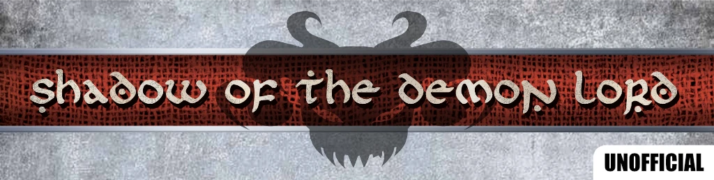

  

  # Shadow of the Demon Lord

  Game system for [Encounter+](https://itunes.apple.com/us/app/encounter+/id1170693487?ls=1&mt=8)

  
  
  

  [🇫🇷 Version française](README.md)

> [!NOTE]
> This system does not contain any game content (rules, ancestries, paths, spells, items, creatures, images…). It provides the structure the system needs: sheets, views, theme and settings. Content must be entered manually in the Encounter+ library or come from modules you own.

## What is *Shadow of the Demon Lord*?

*Shadow of the Demon Lord* is a dark fantasy role-playing game created by [Robert J. Schwalb](https://schwalbentertainment.com). The world is in agony, ravaged by famine, war and epidemic, and the end times are near. The Demon Lord draws closer.

The rules rest on one idea: roll a d20, add an attribute modifier, and succeed on a 10 or more. Circumstances grant boons or banes, six-sided dice (d6) whose highest result is added to or subtracted from the d20. A character is built in three steps: an ancestry (human, dwarf, goblin…), then paths (novice, expert and master) that grant talents and spells over ten levels. The game also tracks Insanity and Corruption, which slowly mark those who face horror.

## Installation

1. Download `sotdl.system` from the [latest release](https://github.com/BriocheMasquee/sotdl/releases/latest).
2. Open the file with Encounter+ (Settings, then Import). The system installs and becomes the primary system.

The system requires Encounter+ 5.2.0 or later (interactive sheets).

## What the system provides

- **Entities**: character, creature, NPC, vehicle, spell, item, ancestry, transformation, complication, path, rule and table.
- **Interactive character sheet**, with a GM card that opens the full sheet.
- **Views** for every entity, with a theme inspired by the books.
- **Combat tracker**: damage bar for characters, creatures and NPCs, and Defense display. The tracker's afflictions are linked to Affliction rules.
- **Text** in French (VF) and English (VO).

## System settings

**Initiative.** The system settings ("Combat Tracker" group) reuse Encounter+'s own: automatic roll, grouping and reroll every round. In the game, players choose a fast or slow turn, which the GM handles by hand.

**Images.** The system settings ("Interface" group) let you choose which image is shown in lists and in the combat tracker: icon, image or token.

## Using the character sheet

**Creation and levels**: the sheet guides creation (ancestry, transformation, complication, attributes, languages, professions) and then each level-up (paths, talents, attributes, spells). A completed step can be undone. The "Level up" button shows how many choices remain.

**Tabs**: Actions, Magic, Talents, Bag and Character. Talents, spells and actions unfold as accordions, with usage boxes. A roll starts with one click, with boons and banes.

**Damage**: the bar counts damage taken (wounded at half Health, incapacitated at the maximum). A rest heals and restores uses.

**Calculations**: values are computed from the ancestry, paths and equipment. The "Calculations" section lets you adjust them: base, bonus or forced value for each characteristic, attribute and for size.

**Afflictions**: they are set on the sheet and appear in the combat tracker.

**Character form**: three tabs (Identity, Magic, Bag) to choose entities and edit their copy in detail. Everything else is done from the sheet.

## Author's permission, credits and licenses

Robert J. Schwalb, the author of the game, allowed this system to be distributed free of charge to Encounter+ users (February 2024), on one condition: that it contains no game element. This repository and the system settings carry the author's credits. The content you enter or import remains your responsibility, and the Encounter+ community forbids sharing paid or copyrighted material.

*Shadow of the Demon Lord* is a game by Schwalb Entertainment, LLC, created by Robert J. Schwalb. This system was made by Brioche Masquée.

*Shadow of the Demon Lord is ©2015 Schwalb Entertainment, LLC. All rights reserved. Shadow of the Demon Lord, Schwalb Entertainment, and their associated logos are trademarks of Schwalb Entertainment, LLC.*

Fonts: Athelas, Montserrat and Aquifer.

The code and files of the system are published under the [MIT License](LICENSE), excluding the game itself and its trademarks, which remain the property of Schwalb Entertainment.
