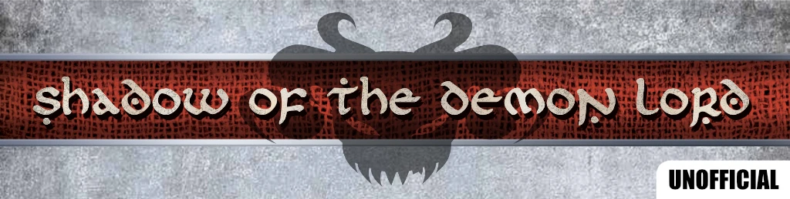

  

  # L'Ombre du Seigneur Démon

  Système de jeu pour [Encounter+](https://itunes.apple.com/us/app/encounter+/id1170693487?ls=1&mt=8)

  
  
  

[🇬🇧 English version](README-en.md)

> [!NOTE]
> Ce système ne contient pas de contenu du jeu (règles, ascendances, voies, sorts, objets, créatures, images…). Il fournit la structure nécessaire au système : les fiches, les vues, le thème et les réglages. Le contenu doit être saisi manuellement dans la bibliothèque d'Encounter+ ou provenir de modules que vous possédez.

## Qu'est-ce que *L'Ombre du Seigneur Démon* ?

*Shadow of the Demon Lord* (en français *L'Ombre du Seigneur Démon*) est un jeu de rôle de dark fantasy créé par [Robert J. Schwalb](https://schwalbentertainment.com). Le monde est à l'agonie : famine, guerre et épidémie le ravagent, et la fin des temps approche. Le Seigneur Démon approche.

Les règles tiennent en une idée : on lance un D20, on ajoute un modificateur d'attribut et on réussit à 10 ou plus. Les circonstances donnent des avantages ou des désavantages, des dés à six faces (D6) dont le plus haut résultat s'ajoute ou se retranche au D20. Un personnage se construit en trois temps : une ascendance (humain, nain, gobelin…), puis des voies (apprenti, expert et maître) qui donnent des talents et des sorts au fil de dix niveaux. Le jeu suit aussi la Folie et la Corruption, qui marquent peu à peu ceux qui affrontent l'horreur.

## Installation

1. Téléchargez `sotdl.system` dans sa [dernière version](https://github.com/BriocheMasquee/sotdl/releases/latest).
2. Ouvrez le fichier avec Encounter+ (Réglages, puis Import). Le système s'installe et devient le système principal.

Le système demande Encounter+ 5.2.0 ou plus récent (fiches interactives).

## Contenu du système

- **Entités** : personnage, créature, PNJ, véhicule, sort, objet, ascendance, transformation, complication, voie, règle et table.
- **Fiche de personnage interactive**, avec une carte MJ qui ouvre la fiche complète.
- **Vues** de chaque entité, avec un thème inspiré des livres.
- **Suivi de combat** : barre de dégâts pour les personnages, les créatures et les PNJ, et affichage de la Défense. Les afflictions du suivi de combat sont reliées aux règles de type Affliction.
- **Textes** en français (VF) et en anglais (VO).

## Réglages du système

**Initiative.** Les réglages du système (groupe « Gestion des combats ») reprennent ceux d'Encounter+ : lancer automatique, regroupement et relance à chaque round. Dans le jeu, les joueurs choisissent un tour rapide ou lent, que le MJ gère à la main.

**Images.** Les réglages du système (groupe « Interface ») permettent de choisir l'image affichée dans les listes et dans le suivi de combat : icône, image ou jeton.

## Utilisation de la fiche de personnage

**Création et niveaux** : la fiche guide la création (ascendance, transformation, complication, attributs, langues, professions) puis chaque montée de niveau (voies, talents, attributs, sorts). Une étape faite peut être annulée. Le bouton « Monter de niveau » indique le nombre de choix restants.

**Onglets** : Actions, Magie, Talents, Sac et Perso. Les talents, sorts et actions se déplient en accordéon, avec cases d'utilisation. Un jet part d'un clic, avec avantages et désavantages.

**Dégâts** : la barre compte les dégâts subis (blessé à la moitié de la Santé, neutralisé au maximum). Un repos soigne et rend les utilisations.

**Calculs** : les valeurs sont calculées à partir de l'ascendance, des voies et de l'équipement. La section « Calculs » permet de les corriger : base, bonus ou valeur forcée pour chaque caractéristique, attribut et pour le gabarit.

**Afflictions** : elles se posent sur la fiche et apparaissent dans le suivi de combat.

**Formulaire du personnage** : trois onglets (Identité, Magie, Sac) pour choisir les entités et modifier leur copie en détail. Tout le reste se fait depuis la fiche.

## Autorisation de l'auteur, crédits et licences

Robert J. Schwalb, l'auteur du jeu, a autorisé la diffusion gratuite de ce système aux utilisateurs d'Encounter+ (février 2024), à une condition : qu'il ne contienne aucun élément du jeu. Ce dépôt et les réglages du système portent les crédits de l'auteur. Les contenus que vous saisissez ou importez restent votre responsabilité, et la communauté d'Encounter+ interdit le partage de contenus payants ou protégés par le droit d'auteur.

*Shadow of the Demon Lord* est un jeu de Schwalb Entertainment, LLC, créé par Robert J. Schwalb. Ce système a été réalisé par Brioche Masquée.

*Shadow of the Demon Lord is ©2015 Schwalb Entertainment, LLC. All rights reserved. Shadow of the Demon Lord, Schwalb Entertainment, and their associated logos are trademarks of Schwalb Entertainment, LLC.*

Polices : Athelas, Montserrat et Aquifer.

Le code et les fichiers du système sont publiés sous [licence MIT](LICENSE), à l'exclusion du jeu lui-même et de ses marques, qui restent la propriété de Schwalb Entertainment.
